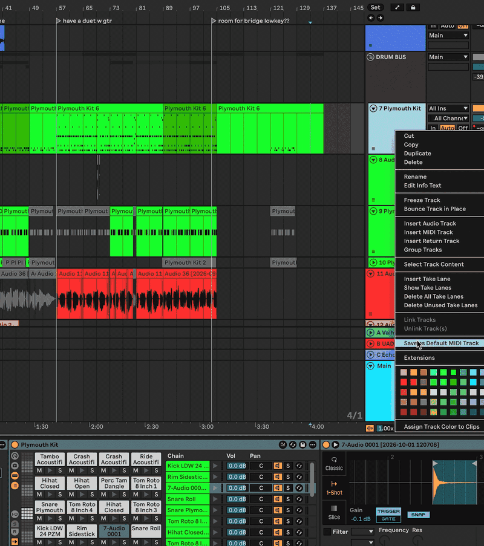

# Ableton Extension: racks2tracks

Split your Drum Rack chains into individual MIDI tracks!



<!-- -->

## Why I Built This

Isolating Drum Rack chains is tedious if you want to preserve your kit's gain mix and processing. You'd have to duplicate the track for every chain, then delete all the other chains to avoid redundant plugin bloat. This extension let's you do it in one click.

<!-- -->

## Features

racks2tracks gives you two ways to split your racks directly from a MIDI track's context menu:

| Mode | How It Works | Best For |
| :--- | :--- | :--- |
| **Split Drum Rack (Fast)** | Duplicates tracks in parallel & bypasses unused devices | Stock kits, lighter projects, or when CPU/RAM overload isn't a concern. |
| **Split Drum Rack (Deep)** | Sequentially duplicates each track & physically deletes all unused plugins | Plugin-heavy racks (Kontakt, Serum, heavy AUs) and lower-end CPUs to prevent crashes and free RAM. |

> [!TIP]
> After running **Deep Split**, using "Bounce Track in Place" on all new tracks is recommended to conserve the most CPU usage.

<!-- -->

## Requirements

* **Ableton Live 12 Beta** (`12.4.15b6` or higher)
* macOS or Windows

<!-- -->

## Installation (For Users)

No coding or terminal required:

1. Head over to the **[Releases](https://github.com/nmxd-mp3/racks2tracks/releases)** tab.
2. Download the latest `racks2tracks-x.x.x.ablx` package.
3. In Ableton Live, go to **Settings** > **Extensions**.
4. Drag and drop the `.ablx` file into the window, or click **Choose file...** and select the `.ablx` to install.

<!-- -->

## How to Use

1. Select any **MIDI Track** containing a Drum Rack in Arrangement View.
2. **Right-click** the track title bar.
3. Choose either:
   * **`Split Drum Rack into individual MIDI tracks (fast)`**
   * **`Split Drum Rack into individual MIDI tracks (deep)`**
4. The progress bar will show which chains are being worked on, so you don't have to wonder if it's frozen!

> [!NOTE]
> Currently only supports clips in Arrangement View.

<!-- -->

## Troubleshooting & Reporting Issues

If something doesn't work as expected:
1. Make sure your clips have active (non-muted) MIDI notes.
2. On macOS, check Ableton's extension logs at:
   `~/Library/Preferences/Ableton/Live 12.x.x/Log.txt`
3. Open a GitHub Issue and paste any relevant lines from Log.txt!

<!-- -->

<details>
<summary><b>For Developers:</b></summary>

If you want to contribute or build `racks2tracks` locally:

### Prerequisites
* **Node.js** `>=24.14.1`
* **Ableton Extensions SDK:** The SDK is currently in private beta via Centercode. To build locally, drop your `ableton-extensions-sdk-*.tgz` and `ableton-extensions-cli-*.tgz` tarballs into the `vendor/` folder.

### Setup & Scripts
```bash
npm install                     # Install dependencies (links vendor tarballs)
npm run build                   # Production bundle (dist/extension.js)
npm run build:dev               # Dev bundle with sourcemaps
npm run package                 # Compile and package into a .ablx archive
npm test                        # Run unit tests
npm start                       # Launch extension in Live's Extension Host
```

</details>

<!-- -->

## License

MIT © nmxd
